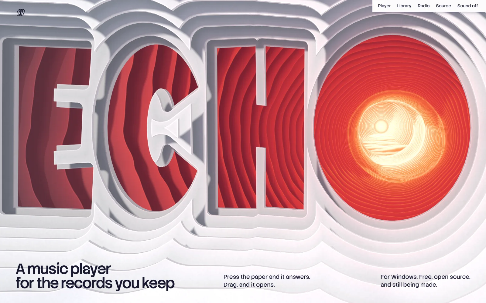
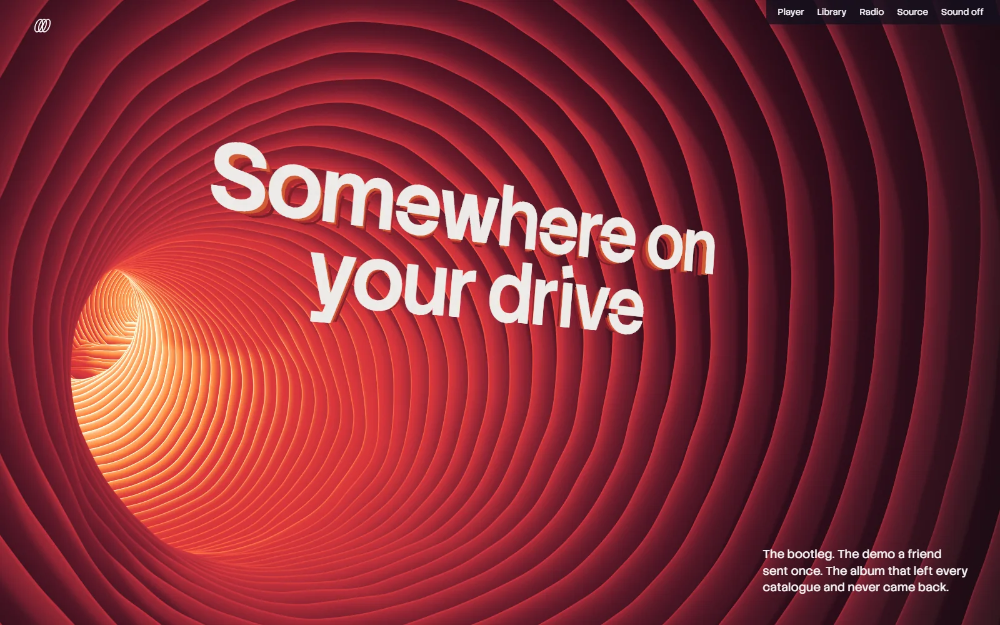
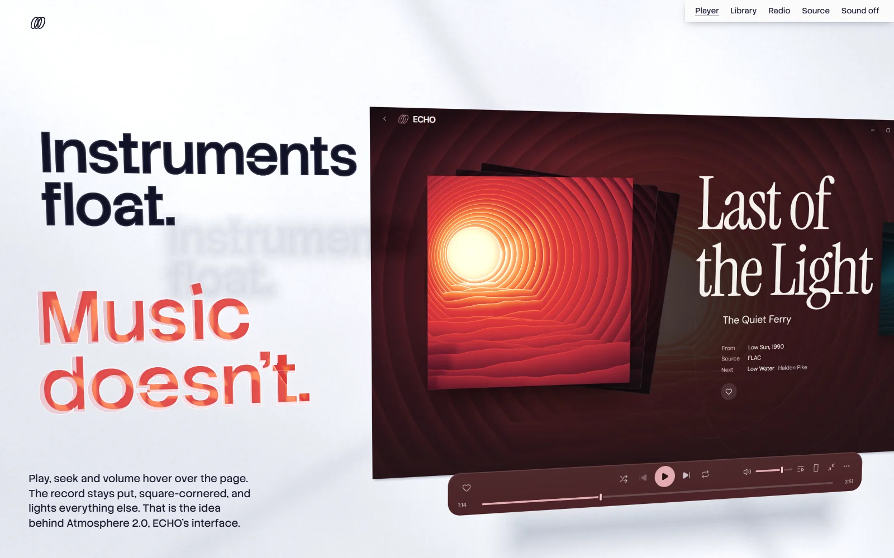
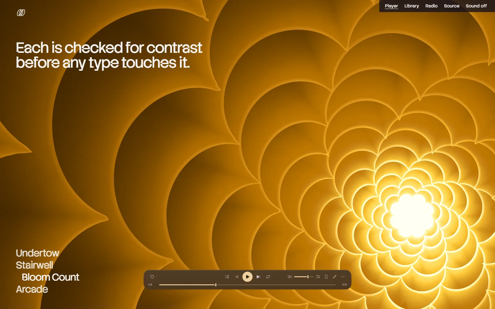
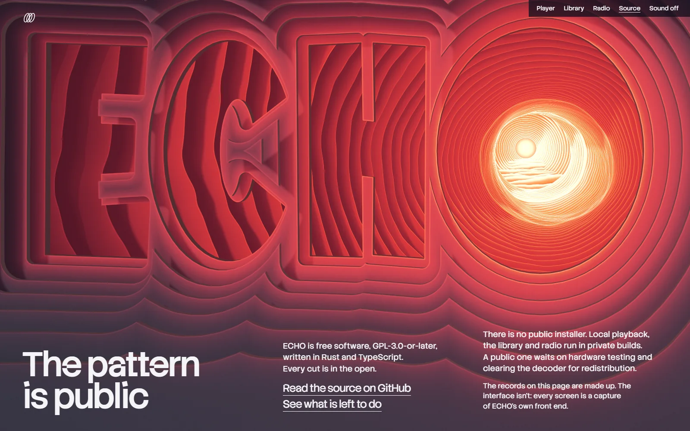

<p align="center">
  
</p>

<h1 align="center">ECHO</h1>

<p align="center">
  The official website of ECHO, a local-first music player for Windows.<br />
  <a href="https://github.com/Venuss1337/echo">The player itself lives here.</a>
</p>

<p align="center">
  
</p>

## Deep cut

The site follows one rule: **the paper is white, and all colour is light from a record.**

Everything is a sheet of paper, cut and stacked. You arrive at a blank one, a blade goes round four letters, and you go in through the O. Music is depth; the player is one more sheet, with the sleeve cut out of it, standing in front of the place the sleeve is a picture of.

There are no models in it, and no textures except the tooth of the paper and captures of the application. Each pixel follows one ray through flat sheets described as distance fields, and lights whatever it meets. Scrolling is the only clock: any moment can be drawn on its own, so going back arrives at exactly the same frame, and nothing is drawn while nothing moves. Radio is the exception, because radio is live.

Press the paper and it answers three times, quieter each time. Drag, and it opens.

<p>
  
  
  
  
</p>

While the film is being prepared, the sheet is blank but not empty: a paper ring turns somewhere out of frame, and only its shadow falls on the page. Each real step that completes gives it another echo, further off and softer. When the first scene has been drawn, the ring comes down along its own light, meets its shadow, and touches exactly where the O will be cut.

## ECHO

[ECHO](https://github.com/Venuss1337/echo) is an open-source desktop music player for Windows, built around the music files you own: local playback, an indexed library, playlists, favourites and history, an immersive Now Playing lit by each sleeve, a compact edition, and internet radio. Its interface is called Atmosphere 2.0. It is in development and has no public release yet.

## Made with

TypeScript, WebGL 2 through [Three.js](https://threejs.org), [Lenis](https://lenis.darkroom.engineering), [GSAP](https://gsap.com) and ScrollTrigger, [Vite](https://vite.dev), [Bun](https://bun.sh) and [Playwright](https://playwright.dev). Set in Stack Sans Notch and Stack Sans Text. It is a static site, and fetches nothing from any other origin.

Visitors who ask for less motion, or whose browser has no WebGL 2, get the same story as prints.

## Building it

```sh
bun install --frozen-lockfile
bun run dev        # development
bun run build      # type check, then dist/
bun run preview    # serve dist/
bun run test       # Playwright against dist/, on a machine with a GPU
```

Release status and links are in [site.config.ts](site.config.ts). Hosting is described in [docs/DEPLOYMENT.md](docs/DEPLOYMENT.md).

## Rights

This repository is public so that the work can be seen. It is **not open source**, and contributions are neither solicited nor accepted. Original website code, design, animation, artwork and text are reserved; see [LICENSE](LICENSE). Libraries, fonts and captures of ECHO keep their own terms, listed in [THIRD_PARTY_NOTICES.md](THIRD_PARTY_NOTICES.md).

ECHO, the player, is a separate open-source project under GPL-3.0-or-later. If you would like to help with it, its repository explains [how](https://github.com/Venuss1337/echo/blob/main/CONTRIBUTING.md).

The records, artists and stations shown on the site are invented. The interface is not: every screen is a capture of ECHO's own front end.
